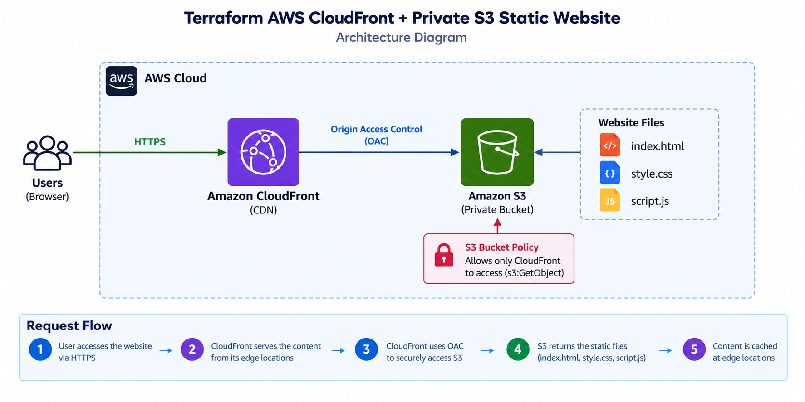

# 🚀 Terraform AWS CloudFront + Private S3 Static Website

A secure static website deployment on AWS using **Terraform**, **Amazon S3**, **Amazon CloudFront**, and **Origin Access Control (OAC)**.

The S3 bucket remains completely private. Users access the website through CloudFront, and CloudFront uses OAC with **SigV4** to securely retrieve the website files.



## 🏗️ Architecture

```text
Users
  |
  | HTTPS
  v
Amazon CloudFront
  |
  | Origin Access Control (OAC)
  | SigV4
  v
Private Amazon S3 Bucket
  |
  +-- index.html
  +-- style.css
  +-- script.js
```

## ⚙️ AWS Services Used

| Service           | Purpose                                               |
| ----------------- | ----------------------------------------------------- |
| Amazon S3         | Stores the static website files                       |
| Amazon CloudFront | Provides CDN delivery and HTTPS                       |
| CloudFront OAC    | Securely connects CloudFront to the private S3 bucket |
| AWS IAM/S3 Policy | Allows only CloudFront to read objects                |
| SSE-S3            | Encrypts objects stored in S3                         |
| Terraform         | Provisions and manages infrastructure                 |

## ✨ Features

* Private S3 bucket with Block Public Access
* CloudFront distribution with OAC + SigV4
* HTTPS access with HTTP → HTTPS redirection
* CloudFront caching + Gzip/Brotli compression
* S3 server-side encryption (SSE-S3)
* Restricted S3 bucket policy
* Static website files managed by Terraform
* Automatic bucket name generation

## 📂 Project Structure

```text
terraform-aws-cloudfront-s3-static-website/
│
├── architecture.png
├── provider.tf
├── variables.tf
├── terraform.tfvars
├── s3.tf
├── cloudfront.tf
├── outputs.tf
│
└── website/
    ├── index.html
    ├── style.css
    └── script.js
```

## 📜 Terraform Files

| File               | Description                                                                  |
| ------------------ | ---------------------------------------------------------------------------- |
| `provider.tf`      | Defines Terraform version, AWS provider, and region                          |
| `variables.tf`     | Defines configurable variables such as region, project name, and environment |
| `terraform.tfvars` | Contains project configuration values                                        |
| `s3.tf`            | Creates and configures the S3 bucket, encryption, and Block Public Access    |
| `cloudfront.tf`    | Creates CloudFront OAC, distribution, cache behavior, and HTTPS redirection  |
| `outputs.tf`       | Displays bucket name, CloudFront ID, CloudFront URL, and S3 ARN              |

## 🔒 Security Architecture

S3 Block Public Access is enabled:

```hcl
block_public_acls       = true
block_public_policy     = true
ignore_public_acls      = true
restrict_public_buckets = true
```

The bucket policy allows the CloudFront service principal to access objects only through the specified CloudFront distribution.

* No direct public access to the S3 bucket
* CloudFront uses Origin Access Control
* Requests from CloudFront to S3 are authenticated using SigV4
* S3 objects are encrypted using SSE-S3

## 🌐 Request Flow

1. User requests the website via HTTPS.
2. CloudFront receives the request.
3. CloudFront checks the edge cache.
4. **Cache Hit** → CloudFront serves the content directly.
5. **Cache Miss** → CloudFront fetches the content from S3 through OAC.
6. CloudFront delivers the content to the user.

## 🛠️ Prerequisites

* Terraform
* AWS CLI
* AWS account
* Configured AWS credentials

Verify the installation:

```bash
terraform version
aws --version
aws sts get-caller-identity
```

Configure AWS credentials:

```bash
aws configure
```

## 🚀 Deployment

Clone the repository:

```bash
git clone https://github.com/<your-username>/terraform-aws-cloudfront-s3-static-website.git
cd terraform-aws-cloudfront-s3-static-website
```

Initialize Terraform:

```bash
terraform init
```

Format the configuration:

```bash
terraform fmt
```

Validate the configuration:

```bash
terraform validate
```

Review the deployment plan:

```bash
terraform plan
```

Deploy the infrastructure:

```bash
terraform apply
```

Confirm with `yes` when prompted.

## 🔎 Verification

Get the CloudFront URL:

```bash
terraform output -raw cloudfront_domain_name
```

Get the S3 bucket name:

```bash
terraform output -raw s3_bucket_name
```

List the website files in the S3 bucket:

```bash
aws s3 ls s3://$(terraform output -raw s3_bucket_name)
```

Expected files:

```text
index.html
style.css
script.js
```

Open the CloudFront domain in a web browser to verify that the website is accessible through CloudFront.

## 📖 Terraform Commands

| Command              | Purpose                          |
| -------------------- | -------------------------------- |
| `terraform init`     | Initialize the Terraform project |
| `terraform fmt`      | Format Terraform files           |
| `terraform validate` | Validate the configuration       |
| `terraform plan`     | Create an execution plan         |
| `terraform apply`    | Deploy the infrastructure        |
| `terraform output`   | Display Terraform outputs        |
| `terraform show`     | Show the current Terraform state |
| `terraform destroy`  | Remove the infrastructure        |

## 🔐 Why CloudFront + Private S3?

* Global content delivery
* HTTPS support
* Edge caching for reduced latency
* Secure access to S3
* No public S3 bucket access
* Improved security through Origin Access Control

## 🔑 Why Origin Access Control?

CloudFront uses Origin Access Control to securely authenticate requests to the S3 origin.

OAC provides:

* SigV4 authentication
* Private S3 bucket access
* CloudFront-only access to website objects
* Improved security compared with a publicly accessible S3 bucket

## 📌 Important Note

This project uses the default CloudFront certificate.

It does not configure:

* Route 53
* Custom domain
* ACM certificates

## 🚀 Future Improvements

* Custom domain + Route 53
* ACM certificate
* CloudFront custom error responses
* AWS WAF integration
* CI/CD with GitHub Actions
* Separate development and production environments
* Terraform modules
* Remote Terraform state

## 🎓 Learning Outcomes

* Terraform + AWS infrastructure provisioning
* Amazon S3 + CloudFront
* CloudFront Origin Access Control
* IAM and S3 bucket policies
* HTTPS and CDN caching
* AWS security best practices
* Infrastructure as Code

## 🧹 Cleanup

To destroy all resources created by Terraform:

```bash
terraform destroy
```

Confirm with `yes` when prompted.

## 👨‍💻 Author

**Aryan Patil**
Computer Engineering Student

## 📜 License

This project is created for learning, academic, and portfolio purposes.
